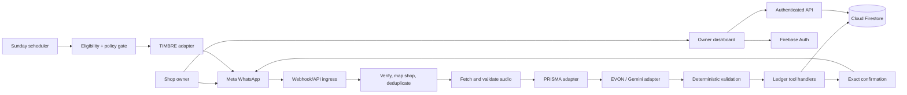
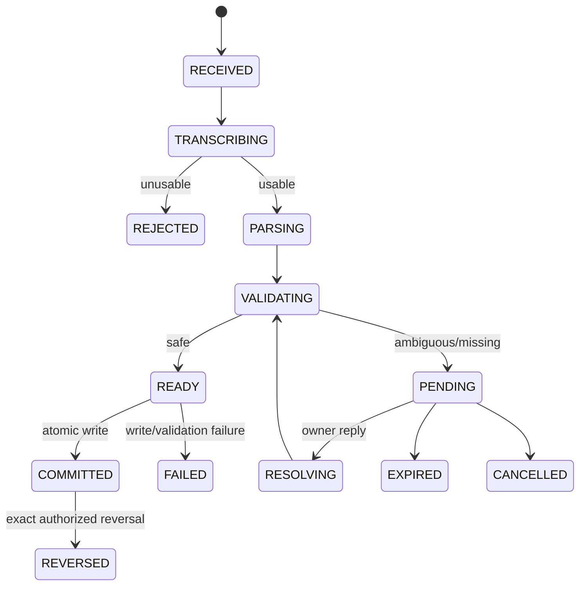
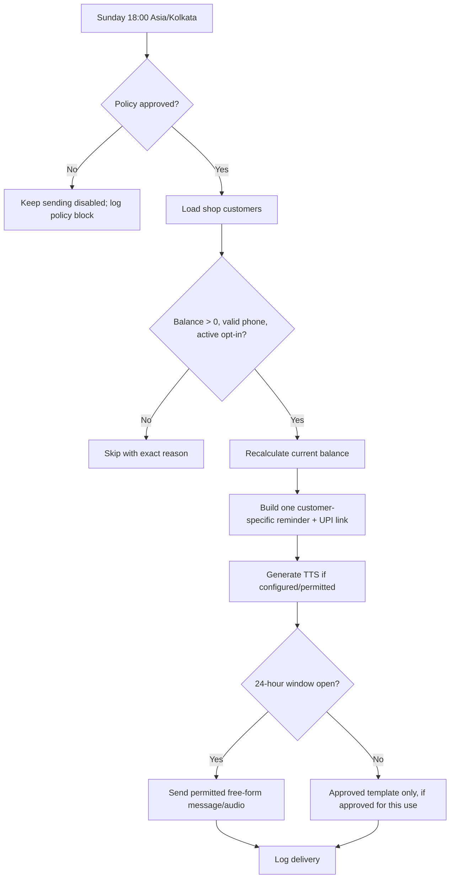

# Udhaar — Architecture

**Status:** Baseline architecture | **Updated:** 2026-11-09

## 1. Decisions and precedence
- **Firebase + Cloud Firestore is the selected backend/database.** This supersedes the Supabase/PostgreSQL label in workflow image 01 because Firebase was selected later.
- Firebase Authentication for owners; Firebase Admin SDK for privileged server operations.
- Preserve the existing frontend framework and Node.js/TypeScript backend where viable.
- Use Cloud Functions only if the project plan and owner approval allow it. Do not silently upgrade Spark to Blaze. A separately hosted Node.js API may connect to Firebase if needed.
- No Payload CMS, Supabase, PostgreSQL, MongoDB or MySQL as a competing source of truth without explicit approval.
- PRISMA = intended STT adapter; EVON = intent/action parser; TIMBRE = TTS adapter. Verify exact provider identities, APIs and capabilities before implementation.
- Gemini is the intended initial EVON LLM provider. NVIDIA NIM is optional, not mandatory.
- Gyani/Gnani name, provider identity and API role must be confirmed from documentation; do not assume capabilities.
- Meta WhatsApp Cloud API is the communication channel. Live credentials/webhook configuration are external tasks.
- Reminder sending stays disabled until the first-party kirana ledger reminder use case is cleared under current Meta/BSP policy.

## 2. System boundaries



Trust boundaries:
1. WhatsApp payloads, audio, transcripts and model output are untrusted.
2. Browser is an untrusted client; it cannot decide shop ownership, authorization or balances.
3. LLM proposes one typed action; it has no database credentials or direct write access.
4. Backend resolves identity, validates money and executes writes.
5. Reminder delivery is a separate outbound capability controlled by consent and policy.

## 3. Voice-to-ledger sequence

```mermaid
sequenceDiagram
 participant O as Owner
 participant M as Meta
 participant B as Backend
 participant S as PRISMA
 participant E as EVON
 participant F as Firestore
 O->>M: Voice note
 M->>B: Webhook(sender, message ID, media ID)
 B->>B: Verify, resolve shop, deduplicate
 B->>M: Fetch media
 M-->>B: Audio
 B->>S: Validated/normalized audio
 S-->>B: Transcript + supported metadata
 B->>E: Transcript + authorized shop context
 E-->>B: Exactly one typed action
 B->>B: Validate schema, identity, amount, scope, idempotency
 alt Safe and unambiguous
  B->>F: Atomic ledger write + audit
  F-->>B: Committed result
  B->>M: Exact confirmation
 else Missing/ambiguous
  B->>F: Save pending clarification; no ledger write
  B->>M: Ask one concise question
 else Unusable input
  B->>M: Reject safely; no partial entry
 end
```

Stages:
1. Verify Meta webhook authenticity using official documentation.
2. Map sender to owner and shop using server-controlled records.
3. Deduplicate by provider message ID.
4. Fetch audio securely; enforce MIME, size and duration limits.
5. Normalize OGG/Opus only as required by the selected STT provider.
6. Transcribe through PRISMA adapter; record language/confidence only if provider returns them.
7. EVON proposes exactly one action.
8. Validate intent, amount, stable customer ID, shop scope, confidence policy and idempotency.
9. Execute deterministic tool handler.
10. Confirm only the committed result.

## 4. Agent actions
- `add_credit`
- `add_payment`
- `get_balance`
- `undo_last`
- `find_entries`
- `undo_entry`
- `ask_clarification`

`find_entries` is read-only. `ask_clarification` never writes a ledger entry. Every mutation requires server-side validation.

Illustrative action envelope (align with existing schemas before changing contracts):

```ts
type AgentAction =
 | { type: "add_credit"; customerRef: string; amountPaise: number; note?: string }
 | { type: "add_payment"; customerRef: string; amountPaise: number; note?: string }
 | { type: "get_balance"; customerRef: string }
 | { type: "undo_last"; confirmationRef: string; reason: string }
 | { type: "find_entries"; customerRef: string; from?: string; to?: string }
 | { type: "undo_entry"; entryId: string; reason: string }
 | { type: "ask_clarification"; question: string; missingFields: string[] };
```

Never trust model-supplied shop IDs, customer IDs or balances.

## 5. Firestore logical data model
Recommended shop-scoped structure (do not migrate a sound existing schema just to match this proposal):

```text
shops/{shopId}
  owners/{ownerId}
  customers/{customerId}
  customers/{customerId}/aliases/{aliasId}
  ledgerEntries/{entryId}
  pendingClarifications/{pendingId}
  whatsappMessages/{messageId}
  webhookEvents/{eventId}
  reminderPreferences/{customerId}
  reminderJobs/{jobId}
  reminderLogs/{logId}
  audioAssets/{assetId}
  paymentLinks/{paymentLinkId}
  paymentReconciliations/{reconciliationId}
  auditLogs/{auditId}
  integrationConfigs/{providerId}
```

Core fields:
- Customer: `displayName`, `displayLabel`, aliases/landmarks, phone if collected, opt-in/out state and timestamps.
- Ledger entry: `shopId`, `customerId`, `type`, `amountPaise`, note, source, source message ID, status, created metadata, reversal reference, reason and revision.
- Pending clarification: shop/owner, original message ID/transcript, proposed action, missing fields, question, status, expiry and resolution message ID.
- Webhook receipt: provider event/message ID, sender, shop mapping, processing state, attempts, last error and correlation ID.
- Audit log: actor, shop, operation, target, reason, timestamp and safe before/after reference.
- Secrets must never be stored in client-readable Firestore documents.

## 6. Financial invariants
- Store money as integer paise; no floating-point arithmetic.
- Reject zero, negative, non-integer and unsafe amounts.
- Define one balance model: derive from posted ledger entries or maintain a denormalized balance updated atomically and periodically reconciled.
- Ledger entry, balance update, idempotency receipt and audit record must be atomic where supported.
- Stable idempotency keys prevent retries from duplicating money movement.
- Never hard-delete posted financial history; use compensating reversal/revision records.
- A UPI link opening/click is not payment proof.
- Balance changes only after a payment is recorded or independently reconciled.

## 7. Clarification/undo state machine



- Ask one concise question in the owner's language where supported.
- No partial entry while clarification is pending.
- Bind reply to a specific pending request. If multiple requests make the reply ambiguous, ask which one.
- Enforce the workflow's ten-minute undo window server-side.
- Undo targets the exact entry linked to the bot confirmation, never merely the latest database entry.
- Older corrections require customer/date lookup, exact entry selection and a reason.

## 8. Dashboard boundary
Owner dashboard areas: Overview, Customers, Customer History, Ledger, Activity/Audit, Reminders, Corrections, Integration Status. Every operation is shop-scoped and server-authorized. Frontend filtering is not security.

## 9. Reminder workflow



Eligibility: positive balance, valid phone, recorded opt-in, no opt-out, shop enabled and policy approved. Recalculate at send time. Each customer receives only their own amount/link. Record delivery or skip reason. Use idempotent scheduled jobs. Reminder sending is hard-disabled pending policy approval.

## 10. API responsibilities
Preserve existing routes; these are logical responsibilities, not mandatory route renames:
- Meta webhook verification/receipt — provider verification.
- Owner/shop resolution — authenticated owner.
- Customer CRUD/history — shop owner.
- Add credit/payment — authorized owner action.
- Balance query — read-only, shop-scoped.
- Reverse entry — owner, exact entry and reason.
- Reminder preferences — shop owner.
- Integration status — authorized owner; never return secrets.
- Provider callbacks — verified provider.

## 11. Runtime, observability and deployment
- Keep local emulator and production configuration separate.
- Use secret manager/environment secrets.
- Never commit credentials or service-account JSON.
- If Spark blocks a needed service, document it and use an approved external Node backend or request billing approval.
- Structured logs: timestamp, severity, correlation ID, shop ID, provider message ID, stage, error code and retry count.
- Do not log secrets, raw audio or unnecessary personal data.
- Emulator success is not proof of live Firebase/provider connectivity.

## 12. Architecture acceptance
- Firebase/Firestore is the sole primary data source.
- LLM has no direct database write access.
- All writes are validated, shop-scoped and idempotent.
- Ambiguous input creates no ledger entry.
- Reversals preserve history.
- Reminders remain disabled until policy approval.
- Emulator tests cover rules and financial invariants.
- Live integration status is reported separately from mocks/emulators.
